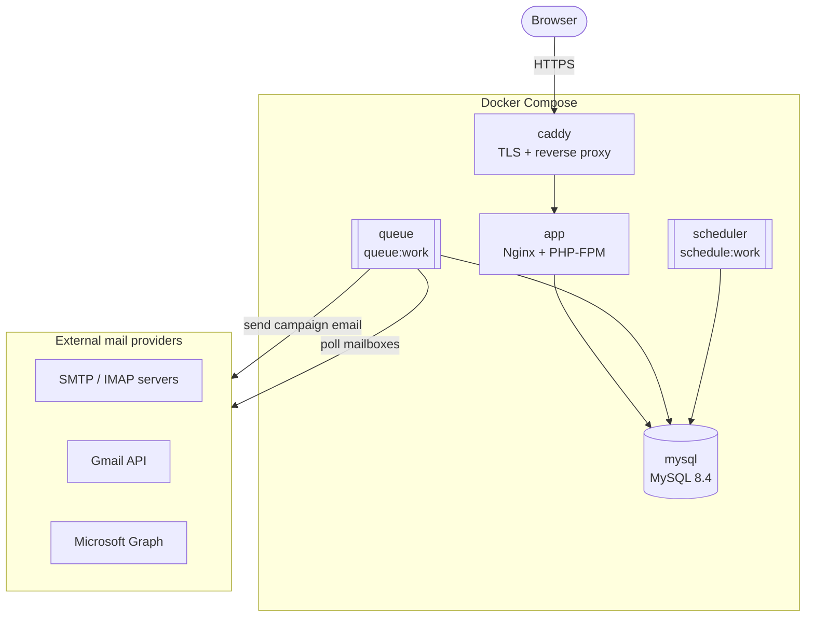

# Architecture

A tour of how Campaigns is put together. For deployment, see [Quick start](./quick-start).

The sections from **Stack** onward are included from [`docs/architecture.md`](https://github.com/contactout/campaigns/blob/main/docs/architecture.md). Edit that file.

## Production services

Rectangles are request-serving services, double-bordered boxes are background processes, and the
right-hand group is outside your deployment. All three PHP containers run the same image and share
the database, which also backs the queue, cache, and sessions. The scheduler only enqueues work: it
dispatches due emails and mailbox checks as jobs that the `queue` worker runs.

| Service     | Role                                                            |
| ----------- | --------------------------------------------------------------- |
| `caddy`     | TLS termination (Let's Encrypt) → reverse proxy to the app      |
| `app`       | Nginx + PHP-FPM (Laravel)                                       |
| `queue`     | `php artisan queue:work` — sends campaign emails                |
| `scheduler` | `php artisan schedule:work` — due emails + reply/bounce polling |
| `mysql`     | MySQL 8.4                                                       |

<!--@include: ../docs/architecture.md#body-->
