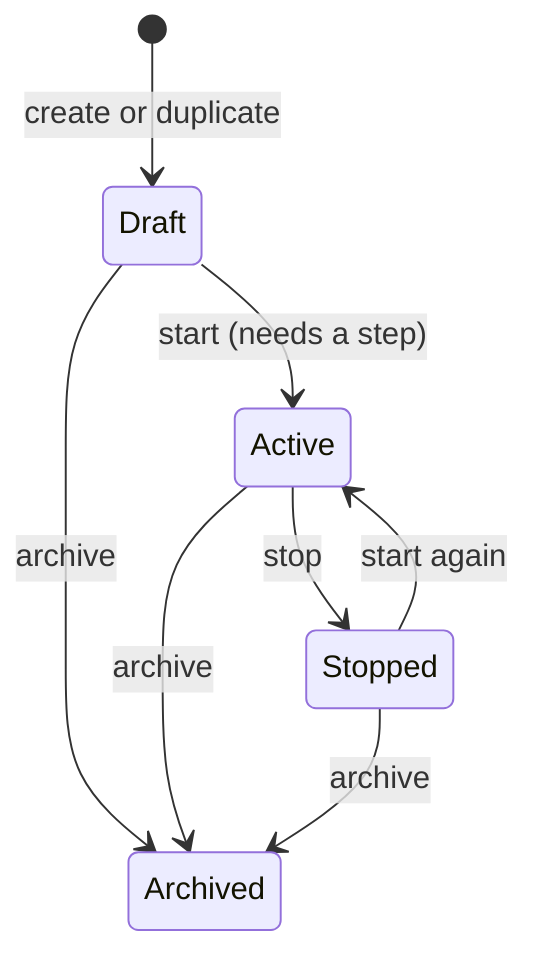
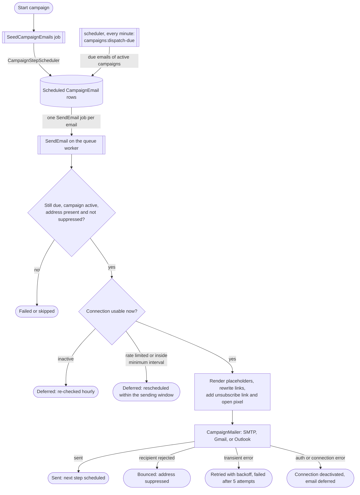
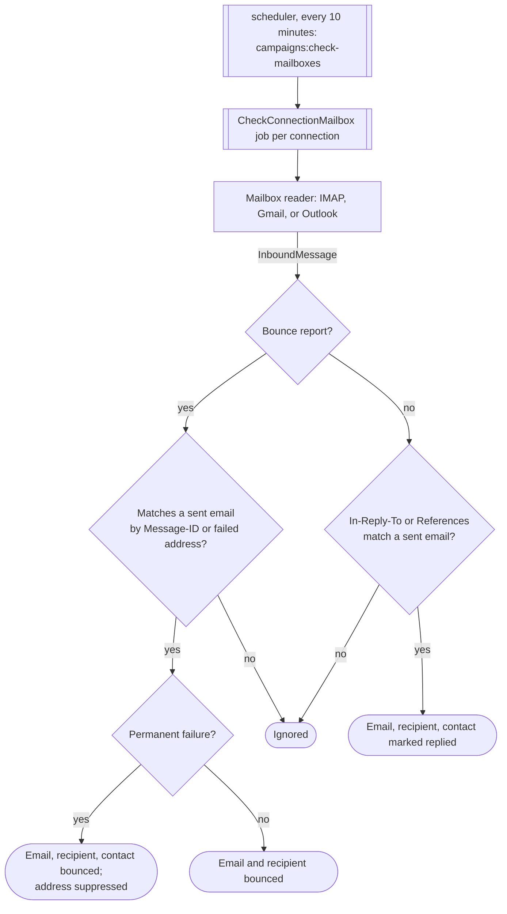

<!-- Included by the VitePress page `docs-site/architecture.md` (region `body`). Keep new sections inside that region. -->

# Architecture

A tour of how Campaigns is put together. For deployment, see the [README](../README.md).

<!-- #region body -->

## Stack

Laravel 13 (PHP 8.4), Inertia v3 with React and Tailwind 4 for the UI, Laravel Fortify for
authentication, and Laravel Wayfinder for typed route helpers on the frontend. MySQL 8.4 in
production (SQLite locally). Queue, cache, and sessions all use the **database** driver, so no
Redis is required.

In Docker Compose, Caddy terminates TLS and proxies to `app` (Nginx + PHP-FPM). Two more
containers run the same image: `queue` (`queue:work`) and `scheduler` (`schedule:work`).

## Domain model

Everything is owned by a **team**. Routes live under `/{current_team}/...`, and the
`EnsureTeamMembership` middleware plus per-model policies keep users inside their team.

| Concept            | Models                                                          | Notes                                                                                                                                   |
| ------------------ | --------------------------------------------------------------- | --------------------------------------------------------------------------------------------------------------------------------------- |
| Teams              | `Team`, `Membership`, `TeamInvitation`                          | Users belong to many teams with a role and permissions (`TeamRole`, `TeamPermission`). Expired invitations are pruned daily.            |
| Contacts           | `Contact`, `ContactIdentity`, `ContactField`, `ContactProperty` | A contact has identities (email, phone) and custom properties defined by team-level fields (the spreadsheet's custom columns).          |
| Lists              | `ContactList` (pivot `contact_list`)                            | Lists group contacts; the UI shows them as tabs in the contacts spreadsheet.                                                            |
| Mailer connections | `MailerConnection`                                              | A sending inbox of type SMTP (optional IMAP), Gmail, or Outlook (`MailerType`). Stores status, rate-limit state, and `last_checked_at`. |
| Campaigns          | `Campaign`, `CampaignStep`                                      | A campaign belongs to a team, uses a mailer connection, and has ordered steps. Lifecycle in `CampaignStatus`.                           |
| Recipients         | `Recipient`                                                     | Links a contact to a campaign and tracks progress (`RecipientStatus`), including replied, bounced, and unsubscribed.                    |
| Campaign emails    | `CampaignEmail`                                                 | One row per recipient per step: scheduled time, message and thread IDs, status (`EmailStatus`), and open/reply timestamps.              |
| Templates          | `EmailTemplate`, `TemplateFolder`, `Signature`, `Placeholder`   | Reusable content for the step editor; placeholders are merge fields rendered per contact.                                               |
| Tracking           | `EmailOpen`, `TrackedLink`, `LinkClick`                         | Open events, rewritten links, and click events.                                                                                         |
| Unsubscribe        | `Unsubscribe`                                                   | Per-team suppression list of addresses and `@domain` entries, read through `SuppressionList`.                                           |

## Campaign lifecycle

Starting a campaign records `started_at` and queues `SeedCampaignEmails`; only `Active` campaigns
send. Stopping keeps scheduled emails in place, so starting again picks up where it left off.
Duplicating creates a new `Draft`. `CampaignStatus` also defines `Completed`, which no action sets
yet.

## Sending pipeline

In detail, `campaigns:dispatch-due` takes due, scheduled emails of active campaigns in batches of 200. Connections with a minimum interval stay out of the batch and get their oldest due email
instead, once their last send is outside the interval. Each `SendEmail` job then:

- skips unless the email is still scheduled and due (one queued job per email)
- skips if the campaign is not active
- fails if the address is missing or suppressed, or no connection is set
- defers an hour if the connection is not active (flagged for resume)
- resets the connection's daily send counter when the UTC day rolls over
- defers 15 minutes if the connection is rate limited (within the sending window)
- defers to the end of the connection's minimum interval since its last send (within the sending window)
- renders placeholders (`PlaceholderRenderer`)
- rewrites links, adds the unsubscribe link and the open pixel (`CampaignBodyBuilder`)
- sends via the `CampaignMailer` for the connection type
- schedules the recipient's next step (`CampaignStepScheduler`)

`SuppressionList` holds the suppression rules for both sending and enrollment
(`AddCampaignRecipients`): a contact is skipped when it has `do_not_contact_at` set, a bounced,
unsubscribed, or do-not-contact status, or any of its addresses matches the team's `unsubscribes`
list exactly or by an `@domain` entry (entries are stored lowercased). Hard bounces, from a send-time rejection or an
inbound report with a `Status: 5.x.x` line, a `55x 5.x.x` reply, or a bare `55x` reply opening a
line or `smtp;` diagnostic, bounce the contact and are added to that list. Other bounce reports,
including delay reports (`Status: 4.x.x` or `Action: delayed`), 5.7.x refusals, full mailboxes
(5.2.2 or bare 552), and bare replies blaming a relay, spam, a blocklist, SPF or DMARC, bounce only
the recipient. A qualifying enhanced code such as 5.1.1 wins over any bare refusal in the same
report.

`CampaignStepScheduler` counts a step's `day` from the later of the campaign start and the moment
the recipient joined, then moves the result onto the campaign's sending window (`SendingWindow`):
the allowed weekdays and hour range, evaluated in the recipient's timezone when it has one.

`CampaignMailerResolver` picks the implementation of the `CampaignMailer` contract:
`SmtpCampaignMailer`, `GmailCampaignMailer` (Gmail API), or `OutlookCampaignMailer`.
OAuth tokens are refreshed by `OAuthTokenManager`. Send jobs make a single queue attempt; when the
mailer throws, `SendFailureClassifier` decides what the failure means:

- **Recipient** (SMTP 550/551/553/554 answering `RCPT TO`, unless it is a 5.7.x or relay policy
  refusal; Gmail 400 "Invalid To header"; Graph 400 `ErrorInvalidRecipients`): the email,
  recipient, and contact are marked bounced and the address joins the team's suppression list. The
  connection is left alone and no further steps are scheduled. The same SMTP codes after `MAIL FROM` or `DATA` reject the sender or the content, so
  they are retried as transient rather than bouncing every contact in turn.
- **Transient** (SMTP 4xx, timeouts and dropped connections, HTTP 429 and 5xx, Gmail 403 rate-limit
  reasons, and anything unrecognised): the email stays scheduled and is retried with exponential
  backoff (15 minutes doubling, capped at 6 hours, within the sending window). The fifth failed
  attempt marks it failed. The attempt count and last error are kept in `campaign_emails.data`.
- **Connection** (SMTP 530/534/535 or a failed login, HTTP 401 or non-rate-limit 403, missing OAuth
  tokens, `invalid_grant` on refresh): the connection is deactivated and the email is deferred.

Deferred emails carry `deferred_for_connection` in `data` and are re-checked hourly. When the
connection is verified again, or an OAuth connection is reconnected, `ResumeDeferredEmails`
reschedules them for the next moment the sending window allows.

## Threading follow-up steps

A step marked `is_threaded` is sent as a reply to the recipient's previous sent email. `SendEmail`
looks that email up and passes an `EmailThread` to the mailer, then stores the ids the next step
needs on the sent email: `message_id` (RFC 5322, also used to match replies), `thread_id` (the
Gmail thread or Outlook conversation), and `reply_to_id` (the Graph message id Outlook replies on).
SMTP sets `In-Reply-To`/`References`; Gmail files the message into the thread id; Outlook creates
the reply on the previous message. An unthreaded step, or a threaded step whose previous email has
no ids, starts a new conversation.

## Replies and bounces

The scheduler runs `campaigns:check-mailboxes` every ten minutes, which queues a
`CheckConnectionMailbox` job per connection. `MailboxReaderResolver` selects a reader
(`ImapMailboxReader`, `GmailMailboxReader`, or `OutlookMailboxReader`) that produces
`InboundMessage` objects. The `ProcessInboundMessage` action first checks for a bounce report and
matches it to the latest email the connection sent, by the Message-ID it refers to or else by the
failed recipient address. Bounce reports often carry `In-Reply-To`/`References`, so this runs before
reply matching. Other messages are matched to a sent email via those headers (a reply). Either way
the email, recipient, and contact status is updated. Unmatched messages are ignored.

## Tracking and unsubscribe

Public routes in `routes/tracking.php` sit outside the authenticated team group:

- `GET /t/o/{campaignEmail}` serves the 1x1 open pixel and records an `EmailOpen`.
- `GET /t/c/{hash}` records a `LinkClick` for a `TrackedLink` and redirects to the original URL.
- `GET|POST /unsubscribe/{recipient}` is protected by Laravel's `signed` middleware; confirming
  writes an `Unsubscribe` row and stops further sends to that address for the team.

Opens and clicks are approximate: mail clients may prefetch or block images. Known proxy user
agents are ignored, and a click records an open as well, because a blocked pixel leaves no other
trace that the message was read. Link rewriting and the pixel can each be turned off per campaign;
the unsubscribe link is always added.

## Directory conventions

| Path                                      | Convention                                                                                                                   |
| ----------------------------------------- | ---------------------------------------------------------------------------------------------------------------------------- |
| `app/Actions/<Domain>/`                   | Single-purpose classes holding write logic (`CreateCampaign`, `StartCampaign`, ...). Controllers stay thin and call actions. |
| `app/Http/Controllers/<Domain>/`          | Inertia controllers and redirect endpoints.                                                                                  |
| `app/Http/Requests/<Domain>/`             | Form Requests for validation and authorization.                                                                              |
| `app/Policies/`                           | One policy per team-owned model.                                                                                             |
| `app/Services/Mail`, `app/Services/OAuth` | Mailers, mailbox readers, rendering, scheduling, and OAuth clients, behind contracts in `app/Contracts/Mail`.                |
| `app/Jobs/Campaigns/`                     | Queue jobs.                                                                                                                  |
| `app/Console/Commands/`                   | Scheduled commands. Schedules are defined in `routes/console.php`.                                                           |
| `app/Enums/`                              | Status and type enums.                                                                                                       |
| `routes/*.php`                            | Split per domain and required from `routes/web.php`.                                                                         |
| `resources/js/pages/`                     | Inertia pages, one directory per domain. Layouts are mapped in `resources/js/app.tsx`.                                       |
| `resources/js/wayfinder/`                 | Generated (gitignored) by Wayfinder from routes and controllers; use its typed URL helpers instead of hardcoding paths.      |
| `tests/`                                  | Pest feature and unit tests.                                                                                                 |

<!-- #endregion body -->
